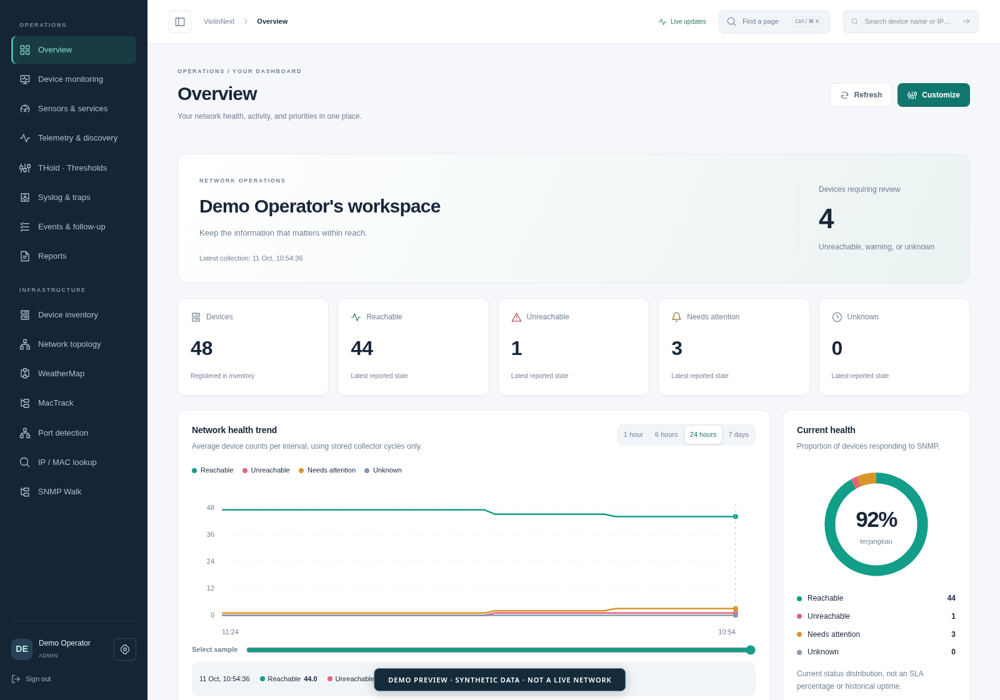
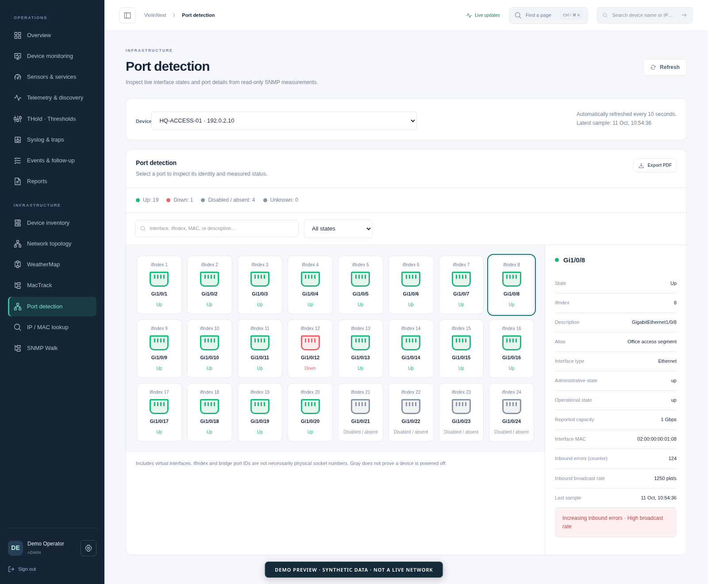
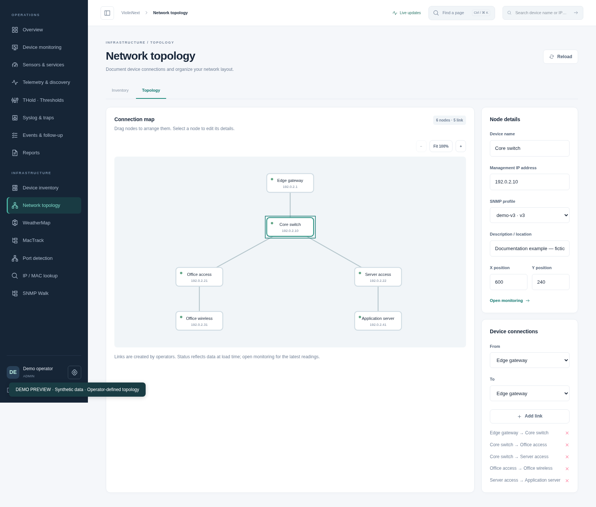
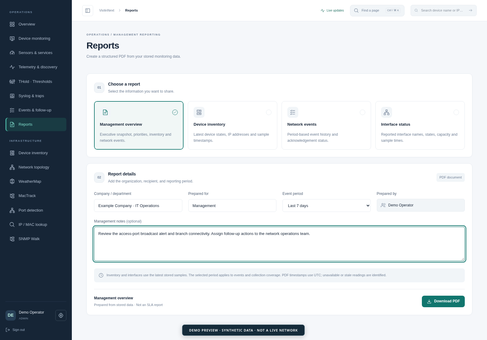

<div align="center">

# ViolinNext

**Self-hosted network monitoring and infrastructure management**

Monitor network health, investigate port issues, and turn device measurements into management reports.

[**Download Beta**](https://github.com/violintvex/ViolinNext/releases) · [Installation](#installation) · [Features](#features) · [Contributing](CONTRIBUTING.md) · [Security](SECURITY.md)


</div>



*Actual application UI with fictional demonstration data; not a live deployment or a performance benchmark.*

**System requirements:** Linux x86_64/amd64, Node.js 22+, systemd, and glibc 2.36+. Node.js is not bundled. ARM and Alpine are not supported by these packages. ICMP sensors also require the system `ping` utility and appropriate permissions.

| Get started | Download |
| --- | --- |
| Debian / Ubuntu | [Download DEB](https://github.com/violintvex/ViolinNext/releases/download/beta-v0.1-build2/violinnext_0.1.0.beta.1-2_amd64.deb) |
| Fedora | [Download RPM](https://github.com/violintvex/ViolinNext/releases/download/beta-v0.1-build2/violinnext-0.1.0-0.beta.1.2.x86_64.rpm) |
| Signature verification | [Download key and signatures](https://github.com/violintvex/ViolinNext/releases/download/beta-v0.1-build2/KEY.zip) · [Verification instructions](#verify-the-download) |

[Verify your download](#verify-the-download), [install the package](#install-the-package), then create your administrator account. See [release status](#release-status) for the beta's tested scope and remaining validation.

## Screenshots

### Port diagnostics

Inspect interface states, measured counters, and per-port warnings.



### Topology view

Organize devices and document connections in an operator-defined topology. Links are maintained by operators; this view does not prove physical connectivity.



<details>
<summary>Management reporting</summary>

Prepare PDF reports with an organization, recipient, reporting period, and management notes.



</details>

All screenshots show the actual interface with synthetic data. Device identities, addresses, measurements, and events are fictional. Screenshot fixtures are isolated from operational data and are not included in installation packages.

## Overview

ViolinNext is a self-hosted network operations platform for IT teams. It combines device monitoring, infrastructure inventory, interface diagnostics, event management, and PDF reporting with role-based access controls.

Monitoring uses actual device responses and stored measurements. SNMP collection is read-only. New samples trigger dashboard updates, with periodic refresh as a fallback. The default SNMP collection interval is 30 seconds; measurement timestamps indicate the age of the data.

## Features

| Area | Capabilities |
| --- | --- |
| **Network monitoring** | SNMP v1/v2c/v3, interface status, bandwidth, errors, and counters |
| **Hardware telemetry** | CPU, memory, storage, temperature, PoE, VLAN, and STP where supported by device MIBs |
| **Service monitoring** | ICMP/Ping, HTTP/HTTPS, DNS, TCP, and numeric SNMP OID sensors |
| **Inventory and discovery** | Device inventory, interface discovery, telemetry profiles, and custom vendor OIDs |
| **Diagnostics** | Visual port detection, high inbound broadcast-rate warnings, increasing inbound error detection, IP/MAC lookup, MacTrack history, and bounded SNMP Walk |
| **Network mapping** | Topology views and WeatherMap with interface traffic visualization |
| **Events and alerts** | Syslog and SNMP trap receivers, custom thresholds, consecutive-sample evaluation, recovery events, and acknowledgment |
| **Notifications** | Telegram, Discord, WhatsApp, and custom HTTPS webhooks |
| **Access management** | Custom roles and permissions, TOTP authentication, session revocation, and audit logging |
| **Reporting** | PDF management summaries, inventory, events, interfaces, and filtered monitoring reports |
| **Configuration archives** | Encrypted storage, text imports, and retrieval from an existing Oxidized service |

Device measurements depend on firmware, MIB support, and configured access. Unsupported readings remain unavailable. IP/MAC observations can identify an uplink or virtual interface and do not always establish an endpoint's physical port.

## Port fault detection

**Available in Beta v0.1 Build 2:** automatic fault classification and evidence-based loop investigation.

Recognized syslog messages identify device-reported loops, MAC flapping, storm-control conditions, error-disabled ports, and link-down reports. The receiver shows a classification with extracted interface names. A message creates an event only when its source IP uniquely matches an inventory device; unmatched or ambiguous sources remain visible as messages. UDP syslog source identity is not authenticated, so a device report is evidence to investigate, not independent confirmation.

A **suspected loop** is raised when the same MAC has at least three recorded moves within five minutes and its mapped interface also has a high inbound broadcast rate. This requires MacTrack/discovery collection and supported forwarding tables. Mobility, uplinks, and legitimate topology changes can produce similar symptoms; verify the event evidence before acting.

Detections appear in **Events & follow-up** and use configured warning-event notification destinations. Repeated events of the same kind on the same device/port are suppressed for ten minutes. Acknowledgment records operator review; silence does not prove recovery. No ports are automatically disabled.


- **High broadcast rate:** flags a port when its measured inbound broadcast rate exceeds `BROADCAST_THRESHOLD_PPS` (default: **800 packets/second**). This is a threshold-based warning, not proof of a network loop.
- **Increasing inbound errors:** flags a port when its inbound error counter increases between valid collection samples.
- **Interface states:** displays operational and administrative states, including up, down, disabled/absent, and unknown. A gray port does not prove that the device is powered off.
- **STP visibility:** collects supported spanning-tree states through device MIBs for investigation. STP blocking alone is not classified as a loop.

Counter-based warnings need comparable samples and supported counters. Short bursts between collection intervals may not be captured. Monitoring is read-only: ViolinNext does not automatically shut down a port or change STP configuration.

## Installation

### Download

Get the packages from [GitHub Releases](https://github.com/violintvex/ViolinNext/releases/tag/beta-v0.1-build2). The download links and system requirements are listed at the top of this page. Application dependencies are included; Node.js must already be installed from a trusted distribution or vendor repository.

Download `KEY.zip` alongside your package and extract its contents. The bundle contains the public key, the Debian detached signature, and the signed checksum manifest. It does not contain a private signing key.

### Verify the download

**Build 2 signing status: verified.** The RPM contains an OpenPGP signature, and the Debian package has a detached `.deb.asc` signature. Both package signatures and the detached `SHA256SUMS.asc` manifest signature were verified locally on 11 October 2026. All files listed in the manifest matched their checksums.

Extract `KEY.zip` and copy its files from the `KEY/` directory into the same directory as the downloaded package. Build 1 signatures cannot verify Build 2 packages.

**Build 2 release key fingerprint:**

```text
70B2F33BB11B5C967073C57C649D9109AC9AA517
```

Before importing `VIOLINTVEX-PUBLIC-KEY.asc`, compare its full fingerprint with a separately trusted maintainer announcement:

```sh
gpg --show-keys --with-fingerprint VIOLINTVEX-PUBLIC-KEY.asc
```

The public DEB asset uses a dot in its filename, while the signed manifest and signature filename use a tilde. Rename the download to match the signed manifest; renaming does not change its contents:

```sh
mv violinnext_0.1.0.beta.1-2_amd64.deb 'violinnext_0.1.0~beta.1-2_amd64.deb'
```

For the Debian package:

```sh
gpg --import VIOLINTVEX-PUBLIC-KEY.asc
gpg --verify violinnext_0.1.0~beta.1-2_amd64.deb.asc violinnext_0.1.0~beta.1-2_amd64.deb
```

For the RPM package:

```sh
sudo rpmkeys --import VIOLINTVEX-PUBLIC-KEY.asc
rpmkeys --checksig --verbose violinnext-0.1.0-0.beta.1.2.x86_64.rpm
```

Require a valid signature from the expected key before installation. A digest-only result or missing key is not successful signature verification. Local APT installation does not automatically check the detached `.deb` signature.

Verify the signed checksum manifest before checking your selected package:

```sh
gpg --import VIOLINTVEX-PUBLIC-KEY.asc
gpg --verify SHA256SUMS.asc SHA256SUMS
```

For the renamed DEB:

```sh
grep -F '  violinnext_0.1.0~beta.1-2_amd64.deb' SHA256SUMS | sha256sum -c -
```

For the RPM:

```sh
grep -F '  violinnext-0.1.0-0.beta.1.2.x86_64.rpm' SHA256SUMS | sha256sum -c -
```

Require both successful signature verification and a matching package checksum. The manifest also lists build records that are not currently separate assets in the public release, so a full `sha256sum -c SHA256SUMS` may report missing files. That does not replace verification of the package you install.

### Install the package

**Debian / Ubuntu**

```sh
sudo apt install ./violinnext_0.1.0~beta.1-2_amd64.deb
```

**Fedora**

```sh
sudo dnf install ./violinnext-0.1.0-0.beta.1.2.x86_64.rpm
```

Installation configures the API and dashboard as systemd services and enables them at boot. Open **http://127.0.0.1:3840** on the installed machine.

Retrieve the installation code to create the first administrator:

```sh
sudo violinnext setup-code
```

There are no default accounts or passwords.


## Initial configuration

1. Create the administrator account using the installation code.
2. Open **Settings → Network settings** and define the networks authorized for monitoring.
3. Add read-only SNMP profiles matching the credentials and security settings on your devices.
4. Add devices to **Device inventory** and save the inventory.
5. Enable **Telemetry & discovery** where metric history and discovery are required.
6. Configure sensors, threshold rules, and destinations under **Bots & notifications**.
7. Define team access through **Roles & permissions** and **User management**.

Permit the collector's source address in device ACLs. Restrict receiver ports to approved senders. Allow at least two collection cycles for bandwidth rates, and check timestamps when assessing device state.

## Operations

### Services

| Command | Purpose |
| --- | --- |
| `sudo violinnext status` | Inspect API and dashboard service status |
| `sudo violinnext start` | Start both services |
| `sudo violinnext restart` | Restart after configuration changes |
| `sudo violinnext stop` | Stop both services |
| `violinnext version` | Display the installed release |
| `journalctl -u violinnext-backend -u violinnext-web` | Inspect service logs |

### Configuration and data

| Location | Contents |
| --- | --- |
| `/opt/violinnext` | Installed application |
| `/etc/violinnext/backend.env` | Private runtime configuration |
| `/var/lib/violinnext` | Database, encryption keys, and persistent settings |
| `/usr/share/doc/violinnext` | Packaged documentation and proxy example |

ViolinNext currently runs as a single-server application using a Node.js API, a Next.js dashboard, and SQLite. Collection cycles do not overlap; slow devices can extend the configured interval.

### Shared HTTPS access

The application listens on loopback by default. For team access, configure a trusted HTTPS reverse proxy using `/usr/share/doc/violinnext/nginx.conf.example`, which targets port 3840.

Set the following values in `/etc/violinnext/backend.env`, replacing the example hostname with your own:

```ini
VIOLINNEXT_LOCAL_DESKTOP=0
ALLOWED_ORIGINS=https://noc.example.com
TRUST_PROXY=loopback
```

Keep the API and dashboard bound to loopback, configure the proxy's TLS certificate, and restart the services.

### Backup and upgrade

Before upgrading, stop the services and back up `/var/lib/violinnext` together with `/etc/violinnext`. Preserve the database's matching encryption key and private settings. Install the newer package, then verify service health and sample timestamps.

Uninstalling the package, including Debian purge, deliberately preserves persistent data and configuration. Remove these directories manually only when permanently retiring the installation. Source installations store their local runtime data under `.violinnext/`.

## Release status

**Beta v0.1 Build 2** includes automatic fault detection, receiver classifications, and per-port warning events. The backend suite passed 89 tests; frontend lint, build, and HTTP smoke checks passed. Both package payloads were extracted and passed application startup and API smoke checks.

Build 1 installation, reinstallation, and data preservation were tested in isolated Ubuntu 24.04 and Fedora 44 environments. Those distribution-level install/upgrade checks have not been repeated for Build 2.

Systemd unit syntax was checked during package preparation. Full hardened service startup still requires a VM or server test because rootless-container namespace restrictions prevented that check. These results do not establish compatibility with every device or capacity for enterprise workloads. The local build records are `BUILD-VERIFICATION.json` and `RELEASE-NOTES.txt`; they are not currently separate assets in the public GitHub release. The summary above reflects those records, not a new test run.

## Security

Use least-privilege monitoring credentials, restrict authorized networks, enable TOTP for administrator accounts, and grant only the permissions each user needs. Protect database backups, encryption keys, and exported configuration archives.

Report suspected vulnerabilities privately to [violintvex@gmail.com](mailto:violintvex@gmail.com). Do not include credentials or customer network information in public issues.

## Source and development

The GitHub repository currently serves as a release and documentation entry point. GitHub's automatically generated **Source code (zip)** contains the repository contents; it must not be confused with the separately uploaded application source.

The release currently includes a legacy `SourceCode.zip` asset. It is pending replacement with a sanitized source distribution and is **not recommended for deployment or redistribution**. Use the signed DEB/RPM packages for installation. A replacement source archive must exclude databases, runtime configuration, encryption keys, setup tokens, dependencies, and generated builds before publication.

When a clean source archive is available, extract it and run the following from the directory containing `backend/`, `frontend-dashboard/`, and `scripts/`. Do not assume that cloning the documentation repository provides these files.

```sh
npm ci --prefix backend
npm ci --prefix frontend-dashboard
API_INTERNAL_URL=http://127.0.0.1:3001 npm run build --prefix frontend-dashboard
node scripts/verify-production.mjs
```

The verification command runs source checks, automated tests, lint, a production build, HTTP smoke checks, and dependency audits. It requires network access for dependency installation and audits. Native module installation may require Python, make, and a C/C++ compiler.

For Linux x86_64 package builds, use a clean source checkout, install `rpmbuild`, GNU tar, binutils (`ar`), and the required Node.js toolchain, then run:

```sh
node scripts/prepare-native.mjs ViolinNext-beta-v0_1-build2-x64
node scripts/build-packages.mjs release/ViolinNext-beta-v0_1-build2-x64
```

Build output goes under `release/`. These scripts expect fresh output directories; keep signed releases outside the build workspace. Locally built packages are unsigned and are not automatically identical to published packages. Package installation, upgrades, hardened systemd startup, and device interoperability require separate acceptance testing.

## Contributing

Bug reports, device compatibility findings, documentation improvements, and feature proposals are welcome. Read [CONTRIBUTING.md](CONTRIBUTING.md), then [report a bug](https://github.com/violintvex/ViolinNext/issues/new?template=bug_report.yml) or [request a feature](https://github.com/violintvex/ViolinNext/issues/new?template=feature_request.yml).

For suspected vulnerabilities, follow [SECURITY.md](SECURITY.md) and contact the maintainer privately. Never attach credentials or customer network data to a public issue.

## Support

For questions, suggestions, and feedback, contact [violintvex@gmail.com](mailto:violintvex@gmail.com).

Voluntary donations support the project:

[](https://sociabuzz.com/violintvex/tribe)
